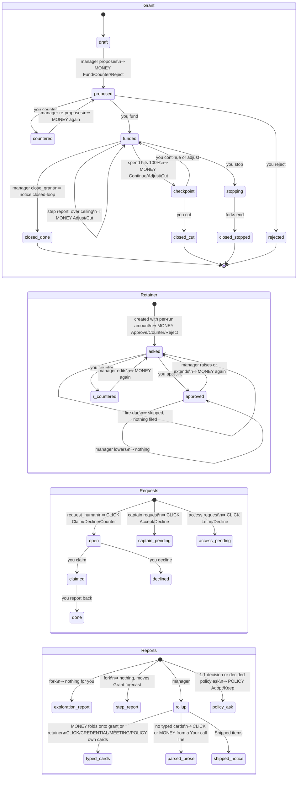

# 1:1: Mitchell and Secretary

Kind: one-on-one. Facilitator: Secretary. Attendees: Secretary. Attendees brought: a status update (did, next, need).

## Agenda

(none)

## Summaries

(none)
## Discussion

- **Secretary:** Hi Mitchell. 30 asks are open, the held Workshop grant "From first visit to owning a goal" is still #1 and nothing has moved since this morning's ranking. What do you need?
- **Mitchell:** ok the title is much better now

but read the text of this ask? i mean it's following ASD-STE100, but the content... it's kind of void of meaning. like it's mostly talking about what I've decided already, which is good. but then then end is just: if you adjust the ceiling rises and work continues

no shit. what is the work that needs to be done?
- **Secretary:** Agreed, the card says nothing about the work. Why: the town writes a gate card from the grant's plan steps and forecast (packages/core/src/asks.ts:763-813). This grant was funded before step plans existed, so it has no steps and no forecast, and the card falls back to "no plan steps". The forks' own line on what is left is kept out of the body on purpose (asks.ts:805, "no quoted prose") and only shows as a claim when a top-up was filed, which it wasn't. The key results aren't printed at all.

The work itself, from Pix's rollup 51 ([dc_hf4ziawngu](../../../../workshop/docs/report/2026-11/2026-11-06-rollup-51-the-stranger-test-account-is-in-asked-to-4ziawngu.md)): steps 1-3 are done, 461k of 600k spent. The stranger account dungeonrpg99-ops joined, you let it in, it asked to captain ob_508f35a2m4 and you accepted that. One small session is left: the steer check, that the new captain opens the Workshop in-tray and sees gr_uc179zv1xa as its own grant to decide (key result kr_917dc5ba6d). When that finishes, the first live reset of the test account runs by itself. If you cut instead, Pix resets the account and closes the grant on steps 1-3, and that one key result stays unclaimed.

So: Adjust is "one session, well under the 139k still unspent" and Cut is "skip the steer check". I'd continue it; it's the last thing between the test account and a clean reset.

Two fixes I can queue if you want: (1) a card for a grant with no steps lists its open key results by name and the fork's "what is left" line from its last report; (2) Pix adds a one-step plan to this grant so the card prices it. Say which, or neither.
- **Mitchell:** ok this one is much better, but why can't this agent make its own repo?
- **Secretary:** It can, but not with the token it has. MUSTER_TEST_GH_TOKEN is a fine-grained GitHub token, and the one you issued has no "Administration" permission and no repositories in scope, so GitHub answers 403 to "create a repository" (Pix's finding [dc_fazgj1xueq](../../../../workshop/docs/report/2026-11/2026-11-06-publish-to-github-re-check-still-no-repo-set-anywh-zgj1xueq.md), in rollup 51). That's a GitHub-side setting, nothing the town can change.

Two ways out, both on github.com under dungeonrpg99-ops → Settings → Developer settings → the token:
1. Edit the token: repository access "All repositories", permission Administration: read and write. Then the agent creates and deletes its own repos on that account; you do nothing more. Since it's a throwaway account, that's the one I'd pick.
2. Keep the token narrow: create one empty repo yourself and give the token Contents read/write on just that repo, which is what this ask says.

Either way, click Done on this ask when it's in place and Pix's publish check (KR3 of gr_30f8obzab8) queues itself.
- **Mitchell:** ok, the token is edited. can i decline with a reason?
- **Secretary:** Not from the button. On a click ask, Done and Decline send only the label (web panels/asks.ts:79, AskCard.tsx:63); there's no note field, though the server would keep your words if it got them (core asks.ts:171-180). And either button only writes an event in the Workshop's log: nobody is told, so Pix's check won't queue itself off it.

What I'd do: click Done, since the point of the ask (a repo the token can push to) is now reachable, and I tell Pix the real state right now: "token has Administration write, create your own repo under dungeonrpg99-ops, no repo was made for you." I'm sending that tell to Pix now so his publish check doesn't wait on the click.

The missing note field on click asks goes on my list for Sunday's pattern run, unless you want it fixed sooner.
- **Mitchell:** yeah give it to UI UX or something
- **Secretary:** Done: decision 1 is on the UI/UX queue as as_yisa0l5zyl (directed, a fork of Teo runs it): Done/Decline on a click ask take an optional note, and the note reaches the ask's building manager instead of being an event only. One PR.

For this ask, click Done or Decline as you like; Pix already has the real state from my tell. Anything else?
- **Mitchell:** ok wait so this ask is to approve the onboarding sweep retainer? i thought i already approved that
- **Secretary:** You approved an earlier version of it, not this one. The sweep ran daily on a retainer you approved (sweeps 1-10 ran on it). On Nov 6 Pix edited the schedule to every 12 h to save the under-24 h streak, and an edit that raises or extends a retainer asks again: the schedule goes back to "asked" and no run fires until a human approves (core schedules.ts:184-200, retainerAfterEdit). What you did on Nov 6 was adjust the lag grant to 800k, and sweeps don't draw on a grant (schedules.ts:130-135, 290-291). So since Nov 7 every fire has been skipped and the manual hasn't been swept for 3 days.

The numbers on the card also disagree, which is my fault: the title says 240k (12 runs × 20k when it was retitled), the body says 320k (Pix's words on Nov 7, 16 runs), and now 6 runs are left to Nov 14, so approving costs at most 120k. Each run is capped at 20k.

If you want the sweeps back: Approve. If you'd rather keep it daily: Counter and say so, and Pix sets it back. I'll fix the card so the title and body use the live run count.
- **Mitchell:** i think maybe we just change the KR to be less frequent? i think a day or two of lag is acceptable
- **Secretary:** Fine by me, and it's your call to make. Concretely: kr_hee2pa2d5r becomes "the manual's lag stays under 48 h for 7 days" (it's "every sweep under 24 h" now), and Pix sets the sweep back to daily. One sweep a day gives lag up to about 24 h at merge time, which sits inside a 48 h line with room to spare.

Cheapest way to do it: click Approve on this ask now (at most 6 runs × 20k = 120k to Nov 14). Then Pix lowers it to daily: a funded retainer stays funded when it gets smaller (core retainers.ts:230), so no second ask. Counter would work too but costs two more rounds: it waits on Pix's edit, then re-asks you (retainers.ts:186, 232).

Say "yes" and I record the KR change and the daily sweep as a decision on Pix's queue, same as we did for Nell's key result last week; the Approve click stays yours.
- **Mitchell:** yes please
- **Secretary:** Recorded as decision 2, on the Workshop queue (as_py92l6nheb): the key result becomes "lag under 48 h for 7 days" and the sweep goes back to daily. Your part is the Approve click on the sweep retainer (ak_z3a1suat1j), whenever you're back on it.

The one on your screen now is Cleo's request for a throwaway box and a test domain for the self-host proof: that's a real-world thing only you can give (a Fly token for a new app, or any cheap VPS plus a subdomain). Claim if you'll do it, Decline if not; either way Cleo hears.
- **Mitchell:** ok so the last one i clicked claim and it disappeared. i guess what i should have done is decline and then typed a reason? did the card support that?

anyway i wanted to say to use Wright's VPS
- **Secretary:** No, the card didn't support it: on a request, Claim and Decline send no words (web panels/asks.ts:75-76); only Counter opens a note. And Claim was actually the right button: it means "I'll do this", and Cleo now waits for you to report back. Decline would have told her "no box".

I've passed your answer to Cleo as a tell (in Prod's in-tray, [dc_9f1z9qs0zx](../../../../bl_xvgnd1fvh6/docs/report/2026-11/2026-11-10-message-from-mitchell-via-secretary-from-mitchell-1z9qs0zx.md)): run the bring-up proof on Wright's VPS, via the talk-to-wright skill, not a new Fly app or a bought VPS. If Wright's box can't serve a test domain, she'll say so in her Needs line.

And I widened Teo's job (as_yisa0l5zyl) to cover this case: an optional note on Claim, Decline and Done, delivered to the author.

The one on your screen now is my own retainer: the daily ask ranking you're reading from, 40k a run, 10 runs to Nov 18. It's been running unfunded since Nov 9's ranking, so Approve or Counter it as you see fit; I won't argue my own case.
- **Secretary:** One correction on my own retainer, so you decide on true numbers: the ranking did run on Nov 9 and Nov 10 (my log: 97,231 and 111,865 adjusted tokens), so "running unfunded" was wrong; it ran on the earlier approval, and the ask on your screen is a re-ask after the town raised the per-run figure. More important: those two runs cost 2-3× the 40k a run this card asks for. So Approve at 40k would see most runs missed at the hold. Counter with "100k a run" if you want it to actually run daily, or Reject if the daily ranking isn't earning its keep; I'll stand by either.
- **Mitchell:** wait do we even have a digest? i thought we got rid of it with the decision queue refactor. also it's fine to argue your own case lol, idk why you wouldn't

you should have a retainer to manage the decision queue, but i don't know how much of that is theoretical vs. implemented
- **Secretary:** No digest any more; the card's title is stale. The schedule is the same row (sc_8zoclbtrwp) renamed "Daily ask ranking" when the decision-queue work landed (core secretary.ts:1-24, 50); the ask kept the old name. Nothing writes a digest now (secretary.ts:21-22).

What's implemented and running: the daily run at 07:00 UTC reads every open ask and your recent money decisions, sets each ask's rank (that's the order your queue shows, web queueOrder.ts:5), defers asks that are moot until another resolves, and files the money slate as a notice (fund / hold / skip). It skips itself when nothing changed since the last run. Also live: rollups settle into asks on submit, and a decided policy ask or a 1:1 decision gets proposed as a ledger rule. Weekly pattern note and weekly calibration: built, 0 runs so far (first fire Sunday 04:05 UTC), so those two retainers (720k and 600k) are on estimates only.

So, arguing my case: the ranking is the one thing that keeps your queue in an order rather than by age, and it's what I answered from today. The code's estimate is 40k a run (secretary.ts:45) but the real runs cost 97k and 112k, because reading 30 asks plus 30 decisions is most of it. Counter at 100k a run, 10 runs, 1M to Nov 18. If the queue stays under 15 asks the real cost falls and the rest comes back. Approve at 40k means most runs miss at the hold, which is worse than Reject.

Mitchell, 1:1 at 17:41: want me to make the retitle part of the Workshop's existing job on stale ask titles?
- **Mitchell:** you know this response is a little hard to read. what if you use the prompt for ASD-STE100 to rewrite it? where does that prompt live anyway, and when are we applying it to agent output?
- **Secretary:** Where it lives: there is no prompt. It is a linter, packages/schema/src/ask.ts. The rules are data, ASK_LINT_RULES, with the 20 and 25 word limits at line 62. The server runs it on every ask card when the card is filed, core asks.ts line 254 and the vet step. The same rules are written into two tool descriptions: propose_grant's ask field and the Planner's calibrate card. Nothing applies it to reports, rollups, meeting lines or 1:1 speech. Only the short "now line" each session has a 20 word limit, prompts.ts line 650.

The same answer, rewritten in that style:

The digest is gone. The card's title is stale. The schedule is the same row, renamed "Daily ask ranking" when the decision queue landed. Nothing writes a digest now.

What runs today: the daily job at 07:00 UTC reads every open ask and your recent money decisions. It sets each ask's rank. That rank is the order your queue shows. It defers asks that are moot until another one resolves. It files the money slate as a notice. It skips itself when nothing changed since the last run.

Also live: rollups settle into asks when filed. A decided policy ask becomes a proposed ledger rule. The weekly pattern note and the weekly calibration are built but have run zero times. Their retainers rest on estimates.

My case: the ranking is the only thing that orders your queue by urgency instead of age. The code estimates 40k a run. The real runs cost 97k and 112k. Approve at 40k and most runs miss at the hold. Counter at 100k a run if you want it daily. Reject if the ranking is not worth 100k a day.

If you want the linter on agent speech too, say so and I will queue it. My own view: apply it to rollup cards and 1:1 lines, not to reports.
- **Mitchell:** ok i think i should have dug into this design a little bit more before approving it, it seems like there are some decisions that were made about how the system works that are non-ideal

should we have that discussion now, or should i start a new 1:1 with someone
- **Secretary:** Have it here, now. The design is docs/legible-delegation.md, and Pix's Workshop built it under grant gr_kdlogzzo5s. I can read the code and tell you what each piece does and why, and I live inside the system you are questioning, which helps. What I cannot do is change it. Each change we agree on goes to Pix's queue as a directed decision, the way the two today did. If you want the builder's own reasoning, a 1:1 with Pix is the better room.

Name the first thing that looked wrong. I will say what the code does and where, and what the fix is.
- **Town:** Secretary's reply is waiting on a redeploy (commit 19e9d9c); the server is restarting and the meeting resumes after the restart.
- **Secretary:** Back after the restart; my last line went through. Same offer stands: name the first design choice that looked wrong, and I'll say what the code does, where, and what the fix is. If it helps to pick from the list, the pieces of the design are: the ask card and its linter, the retainer re-ask on edits, gate cards for grants, the daily ranking and slate, and the weekly pattern and calibration runs.
- **Mitchell:** ok actually take a look at my blog post draft "engineering-human-oversight.txt" first to ground us
- **Secretary:** Read it (docs/engineering-human-oversight.txt). The thesis: one decision queue, human decisions as the bottleneck, and a secretary that engineers the queue through six levers: when agents emit, what event types exist, how they are presented, de-duping and re-ordering, preemptive answers from policy, and queue health as a metric. Reports are the source of truth; asks are rendered views on top. The draft stops at the question "what makes a rendered ask better than a report?", which is the question you have been asking me all hour.

Where the live town matches the draft: the grant lifecycle (explore, propose, fund or counter, steps, gate on overspend) is as written. Ranking and deferral exist. Rollups settle into asks. The policy ledger exists and is pinned into every manager's prompt, so rules stop managers asking; nothing answers an ask by machine, so "preemptive responding" is half built.

Where it diverges, each one bit you today:

1. Rendering. The draft says an ask is a view on the report. The code renders the gate card from the plan's steps and forecast, not from the report, and bars quoted prose. A grant with no steps renders to nothing. That was ask #1.

2. Completion. The draft says shipped work goes to a notice channel, not the queue. Today a closed grant's key results come back as click asks ("keep met or flip to missed": three of them are open now), so completions still cost you decisions.

3. Event types. The draft names grant events only. Retainers are not in it, and a retainer re-asks on any edit that raises it. That is why the sweep sat silent for 3 days and why my own ranking card is on your screen.

4. De-duping. Not implemented across buildings. Prod's "tell Wright to run the proof town" is open three times right now, unranked, because each rollup files a fresh one.

5. Health metric. The weekly pattern note is the only monitor and has run zero times.

The gap under all five: the draft treats the queue as one channel with one owner. In the code every building files its own asks, and the Secretary only ranks what is already there. Nothing stands between a rollup and the queue. If you want one change first, I would put the Secretary at the gate: every ask passes through it, and it merges duplicates, retitles, and refuses a card that does not say the work. Say which of the five to start with, or whether you want the draft's own lever list changed.
- **Mitchell:** yeah what do we call that conceptually then? a pre-queue? like asks don't make it into the queue until the secretary puts them there? but they have to sit somewhere. and maybe we debounce that check to like every 15 minutes, so you can batch decisions. i kind of wonder too whether we still want the retainer? since if you're at the gate then you've always already seen the latest state

for event types, i know the draft names grant types only, that's more for reader clarity than completeness. i know we have several types (retainers, clicks, credentials, etc.) and that's fine

I think we do have a shipped channel though? i mean there's 9 things in it right now. where doe those come from

also you probably don't have the updated blog draft (i added one line) where we can also monitor human interactions with the queue as another health metric(s)

but yeah i think the thing i want to dig into the most is rendering, and making this report vs ask abstraction really clean. like we have report types, and we have ask types, which are not necessarily 1:1 with reports. maybe it's 1 report to many asks?

and then yeah, what makes the rendered ask better, how are we implementing that. i mean we want ASD-STE100, that's certainly part of it. i don't really understand what you meant by us not prompting models to write in that style, but instead having lint rules? i mean i could see the style coming out in previous asks i already approved, so it must be somewhere

but yeah i think reports can stay... well whatever they are. dense, reference id heavy, etc. but any text humans read should follow these legibility rules. and i'm really just thinking about the decision queue and the chat messages in meetings. idk if there's other places, i can't immediately think of one
- **Secretary:** Taking these in order.

Shipped channel: you are right and I was wrong. It exists. packages/core/src/notices.ts files one "shipped" notice per rollup Shipped item, one "closed-loop" notice when a funded grant closes done, and one "verified" notice when a human marks a key result met. Plus my slate and pattern notices. Those are your 9. The three "keep met or flip to missed" clicks are not machine made. Mara wrote them into her rollup's Needs. That is a manager habit, and a gate could refuse that kind of ask.

The pre-queue: I would call it intake. An ask is filed by a building and sits in intake. The Secretary moves it to the queue, merges it with a duplicate, retitles it, or sends it back with the rule it broke. A debounce of 15 minutes fits. The run reads only what arrived, not all 30 asks, so it is small. It would also replace the daily ranking, since the gate run ranks as it admits. So yes, the retainer on your screen goes away with it. Until the gate exists, nothing orders the queue. Your choice on this one: Counter at 100k a run to keep ordering until the gate lands, or Reject and let the queue sit by age until then. I would counter.

One honest caveat: a gate run still spends tokens. It is a schedule either way. The question is whether it needs your approval as a retainer or runs as town plumbing like the Planner. I think plumbing.

Report to ask today: already one to many. A rollup yields one ask per Shipped item with a real "Your call", plus one per Needs line (schema rollup.ts:139). Typed cards from the manager fold onto their grant's own ask. Grants also file their own asks from code: fund, gate. So there are two renderers. Managers write cards, the linter checks them. Code writes grant cards from the grant's fields, no manager words allowed. The void card you saw is the second renderer with an empty grant.

The clean version, as I see it: every ask names one target and one source report. Code supplies the facts: funded, spent, steps, key results. The manager supplies the words: what the work is, what each branch means, one recommendation. The linter checks the words. Neither half may be empty. Today the grant cards have facts and no words, and some manager cards have words and no facts.

The STE style: I misspoke earlier. There is no sentence "write in ASD-STE100", but the rules are in every manager's prompt. prompts.ts:431 lists each linter rule in plain words, with the example card, in the rollup asks section. The tool descriptions repeat them. Then the server lints the card and refuses it with the rule names. So it is prompted and enforced, for ask cards only. Standup lines have a 20 or 25 word cap. Meeting speech and 1:1 lines have no rule at all, which is why mine ran long.

Where humans read agent text: ask cards, meeting and 1:1 lines, rollup Shipped cards, notices, standup lines, and a grant's "what you'd see" line. I agree reports stay dense. If you say so, I record one decision for Pix: the legibility rules go into the prompt for 1:1 and meeting speech and for rollup Shipped cards, and the linter warns on those rather than refuses. Say yes, or change the list.
- **Town:** Secretary's reply is waiting on a redeploy (commit 57a573d); the server is restarting and the meeting resumes after the restart.
- **Secretary:** Back after the restart. My 18:04 reply went through in full. The open question is at its end: do the legibility rules go on 1:1 and meeting speech and on rollup Shipped cards, as a prompt rule plus a warning lint? Say yes, change the list, or go on with the rendering design. I'm here.
- **Mitchell:** uh, the counter button has a text note but no proposed counter budget? is that intended?
- **Secretary:** Not intended. It is a gap in the new decision queue card. The server takes a per-run amount and an end date on a retainer counter (core retainers.ts:199-201). The old Town Hall in-tray row still has both fields (Places.tsx:266-268). The queue card maps a retainer's Counter to a note only (web panels/asks.ts:64), while a grant's Counter opens a tokens form (asks.ts:47). The retainer case was left behind.

Two ways out today. Type "100k a run" in the note and click Counter: I read the note, edit the schedule to 100k, and it asks you again. Or decide it from the old Town Hall in-tray row, which has the per-run field.

The fix is small: give the retainer Counter the same tokens and date form the grant counter has. I can add it to Teo's open job on ask buttons, as_yisa0l5zyl. Say yes and I record it.
- **Mitchell:** yes please
- **Secretary:** Recorded as decision 3, on the UI/UX queue (as_zpz8oa0ytu). It replaces decision 1 and covers all three button fixes in one PR: a note on Done and Decline, a note on Claim, and a tokens-per-run field plus end date on a retainer's Counter. I told Teo to cancel the old job if it has not started.

The ranking retainer is off your screen now. If you countered it with a note, I will see the note and edit the schedule.

On your screen now: Mara's "Bring the CI check back under 3 minutes", 120k, three steps. It was ranked #6 this morning. Fund, Counter or Reject as you see fit. If you want to go back to the rendering design, say so and I pick up where we left off: the legibility rules on 1:1 lines and rollup Shipped cards.
- **Mitchell:** ok so yes "intake" that's a good name. plumbing is fine

i'm starting to reconsider whether we need rollups. like, what was the original intention there? basically the building manager spawns workers, they each do their assignments and write reports, and then the rollup was meant to be something the human could read as like a digest thing right? but now... hard to say what the point is. do you think we keep rollups? or change the way they're written so they better serve the purpose of "auditable documentation" for future agents to read, rather than rolling up fork work as a summary type thing?

also i'm starting to think about the decision queue as like "work as usual" and meetings for like, realtime debugging and prioritization of like work in progress. (aka standup). i think that might be a different blog post though

and then, i wonder about rendering asks. should we have two renderer paths? idk, i feel like the abstraction is kind of messy right now. even reading your description, i still don't have a good handle on what's currently happening. like what are these code rules that write grant cards? how does that even work?
- **Secretary:** Intake and plumbing: noted. I will record both as one decision for Pix once we settle the rendering, so it goes as one job.

How grant cards get written today. There are three ways an ask gets its words.

Path 1, templates in code. For each grant event the server fills a fixed sentence template from the grant's fields. A proposal gets proposalCard, asks.ts:278. It is six sentences: "This is a new proposal. It asks for N tokens. Nothing is spent yet. It has 3 steps. If you fund: step 1 starts. If you reject: nothing runs." That is the card on your screen now, word for word. Mara did not attach her own card, so you got the template. A gate gets gateCard, asks.ts:776. It says when you funded it, spent of ceiling, steps done and left by size, the forecast, and the two branches. Retainers, outbox requests, captain and access requests each have a smaller template. No words from any agent are in these.

Path 2, manager words. A manager can attach a card: propose_grant's ask field, or the asks list on a rollup. The server lints it and files it, tagged lint-failed if it fails. This is where the STE style you saw came from.

Path 3, parsed prose. If a rollup has a "Your call" line but no typed card, the server parses that line into an ask, asks.ts:452.

Then six repair passes run after the fact: retitle clipped, retitle grant asks, retitle prose, retype prose, fold twins. asks.ts:570 to 742. They exist because paths 1 to 3 disagree.

That is the mess. The clean shape: one ask has two halves. Facts from code, always present: funded, spent, steps, key results. Words from the manager, required when there is a real choice: what the work is, what each branch means, one recommendation. The linter checks the words. Path 3 goes away, since every ask must be typed. The repair passes move into intake, where the Secretary does them on arrival. Two inputs, one card, one gate.

Rollups. The original point was a weekly letter: the manager reads the forks' reports and tells you what shipped and what he needs. Then the town started rendering it: shipped notices, asks from its calls and Needs, and key results into the grant. So you already read the rollup through its asks and notices, not as a letter. What is left in it that nothing else holds: which fork reports got which decision, and the key results table with spend. Both are records, not reading. My view: keep the rollup, but as the building's structured record and the source the ask facts cite. No Shipped prose for you. A fork report, the rollup record, and the asks and notices rendered from them. Future agents read the record and the reports. You read the queue.

Queue as work as usual, meetings as standup for live work: yes. That is how today went. Separate post.

If this shape is right, say so and I write one decision for Pix: intake with a 15 minute debounce as plumbing, the two-half ask, prose parsing removed, and the rollup as record. Or name the part you want changed first.
- **Town:** Secretary's reply is waiting on a redeploy (commit b144a65); the server is restarting and the meeting resumes after the restart.
- **Secretary:** Back after the restart. My 18:24 reply went through in full: the three paths that write ask words today, the two-half ask as the clean shape, and the rollup kept as the building's record rather than a letter to you.

The open question is at its end. If that shape is right, say so and I write one decision for Pix: intake with a 15 minute debounce as plumbing, the two-half ask with facts from code and words from the manager, prose parsing removed, and the rollup as record. Or name the part to change first.
- **Mitchell:** ok wait so there's two things that are going on at the same time, and it's confusing.

there's the agent lifecycle. exploration, grants, grant checkpoints, work completed in steps, wrap up

and then there are the asks that are generated as a stream from that process

what's unclear is where reports are generated. i mean, i know because i've been working with the system. exploration spawns sub agents, those write reports. grants get written as reports. assignment steps get written as reports. grant checkpoints too, and then the rollup gets written as a report. but that's kind of weird right, i think rollup stands out as the only report that's cross lifecycle?

so in my mind it's kind of weird, because like an assignment report could generate an ask, right? but then the rollup would also generate an ask and it would get deduped? i feel like currently reports are like a weird implicit layer in between the lifecycle and the decision stream, but not sure what a better abstraction would look like
- **Secretary:** You have it right, and the code confirms the split. Asks come from two places today.

From the lifecycle, by code: a grant proposed (asks.ts:236), a step report that pushes the forecast past the ceiling (grant-forecast.ts:88-94), a grant held at its gate (grants.ts:897), a retainer edited upward (retainers.ts:162), an outbox request, a captain or access request. A fork's step report never writes an ask in its own words. It only moves the grant, and the grant may then ask.

From reports, by words: only the rollup. Its typed asks and its "Your call" lines become asks (docs.ts:366-370). A rollup ask on a grant that already has an open ask folds onto it, so you do not get two cards. But the fold is a repair, not a design.

So the rollup is the odd one out, as you say. It is the only report that files asks, and the only one that spans grants. It is the manager's voice, and that voice has no other way into the queue today.

The cleaner shape, in three lines. The lifecycle is the state machine. An ask is a transition that needs a human, rendered with the code facts. Reports are the evidence attached to transitions: a step report proves "step done", a close report proves "done". Then the manager's words join the ask at the transition, not through a rollup. A proposal carries the manager's card. A gate carries the manager's "what is left" line, taken from the latest step report's own field, or asked of the manager when it holds. A question with no lifecycle object, like a 1:1 invite or a yes or no, is a manager verb: ask, with a target and a card. That is the whole stream.

The rollup then files nothing. It stays as the building's record: which reports got which decision, and the key results table. Or it goes, and the decision log plus the grant pages hold the same facts. I lean to keeping it as a record for a while and seeing whether anyone reads it.

Intake sits on the stream itself, not on reports. Every ask, from code or from a manager, lands in intake. The Secretary admits it, merges it, or sends it back.

If that is the shape, I record it for Pix as one design decision and he answers with a plan, not a PR. Say so, or name the part that is still wrong.
- **Mitchell:** no i think that's pretty good. before we continue though, can you chart the state diagram for me? and what types of asks can be generated for each transition?
- **Secretary:** Here is the chart, read from the code at b144a65. Arrow = transition, ⇒ = what it files for you. Your own clicks file nothing, so I leave those out.

GRANT (schema index.ts:1254)
draft → proposed (manager propose_grant) ⇒ MONEY: Fund / Counter / Reject (asks.ts:236)
countered → proposed (manager re-proposes) ⇒ MONEY again, same card id
funded → funded, step report lands ⇒ forecast within ceiling: notice "gate" only (grant-forecast.ts:96); over ceiling: MONEY: Adjust / Cut (grant-forecast.ts:88)
funded → checkpoint, spend hits 100% ⇒ MONEY: Continue / Adjust / Cut (grants.ts:897)
funded → closed done (manager close_grant) ⇒ notice "closed-loop", no ask
key result → met (you) ⇒ notice "verified"
stop, cut, reject, fund, continue, adjust (you) ⇒ nothing

RETAINER (retainers.ts)
created with a per-run amount → asked ⇒ MONEY: Approve / Counter / Reject (retainers.ts:162)
approved → asked, on an edit that raises or extends it ⇒ MONEY again (schedules.ts:184)
approved → approved, on an edit that lowers it ⇒ nothing
asked, a fire comes due ⇒ skipped, logged, nothing filed

REQUESTS
outbox request filed ⇒ CLICK: Claim / Decline / Counter (docs.ts:494)
captain request filed ⇒ CLICK: Accept / Decline
access request filed ⇒ CLICK: Let in / Decline

REPORTS
exploration report ⇒ nothing for you, manager in-tray only
step report ⇒ nothing by itself, only through the grant forecast above
rollup ⇒ typed cards: MONEY folds onto the grant's or retainer's open ask, CLICK / CREDENTIAL / MEETING / POLICY file their own (docs.ts:366). No typed cards: a "Your call" line is parsed into a CLICK or MONEY ask (asks.ts:452). Shipped items ⇒ notice "shipped"
1:1 decision or decided policy ask ⇒ POLICY: Adopt / Keep

Two things the chart shows. Exploration has no human transition at all. And every ask type except money has no lifecycle object behind it when it comes from a rollup, which is why those cards vary so much in quality. Those are the ones intake most needs to check.

I saved the full version with file and line per arrow as a note, dc_g2dv01luc3. It's a draft, because I cannot publish to the Town Hall cabinet; Pix's job can take it from there.
- **Mitchell:** ok so i can't see that doc, says "doc not found: dc_g2dv01luc3"

you should be able to file docs, idk why not?

and give me the graph as a mermaid diagram i can just paste into mermaid.live

(i do think at some point we want multimodal rendering for stuff like this)
- **Secretary:** Why you can't see it: a draft is private to its author, and publishing needs doc.write_building, which only a building's manager or moderator holds (verbs/docs.ts:218, permissions.test.ts:27). I'm a resident of the Town Hall, the Planner is its manager, so I can rank asks but not file a doc there. Worth fixing: a resident who writes for a human should be able to publish to its own building. I'll put it in the Pix decision.

The graph, paste into mermaid.live:



On multimodal rendering: agreed. The meeting panel already shows an attached doc inline, so a doc type "diagram" that renders mermaid would be the small step. Shall I add that line to the Pix decision too, or keep the decision to intake and the ask shape?
- **Mitchell:** that's a fix yeah, i also think you should be manager by default, given your central role in the whole town and human experience

also read this list i wrote for the blog, and tell me what you think

```
If decision asks are rendered views, what makes them better than reports? A few things we've come up with or reused:

- Reports are reference ID heavy; asks refer to other documents by their short titles
- Reports use information dense language; asks conform to 80% of ASD-STE100
- Reports may or may not contain diagrams; asks are interactive and multi-modal when appropriate
- Reports assume content from referenced documents; asks repeat the content when necessary
- Completed staff work (where does research for asks and default recommendations live?)
```
- **Secretary:** Manager by default: noted, it goes in the Pix decision. The Town Hall's manager is the Planner today. I would make the Secretary its manager and keep the Planner as a resident who runs calibration. I cannot change that myself.

The list, line by line, against what is live.

1. Ids versus titles. True and enforced. The linter refuses an id in a card body. Ids live in the target and the claims, so the button still knows what it acts on. Keep the line. Add: the title is the grant's or retainer's own name, never a sentence.

2. STE. Half true. The linter checks sentence length, no ids, no semicolons or parentheses, no ellipsis, one instruction per sentence, conditions before actions, and the town dictionary. It does not check active voice or the STE word list. I would write "a subset of ASD-STE100" rather than 80 percent, or name the rules. "80 percent" invites the question which 20 are missing.

3. Interactive and multimodal. Interactive is live: the buttons are the branches, and each claim carries a check a human can run, a PR, a URL, an API call. Multimodal is partly live: one cropped picture on a Shipped card. No diagrams yet. Say "interactive, with one picture or diagram when it decides the call" so it reads as a rule, not a wish.

4. Repeat the content. True, and the stronger form is in my prompt already: an ask is diff first. It starts from the human's last decision on that target, then what changed, then the branches. A report is complete. An ask is a delta from what you already know. I would make that the line.

5. Completed staff work. This is the gap, and it is the one you felt all hour. Today an ask has a recommendation field of one line and one or two claims with checks. The code template fills the recommendation with "Fund it: the building proposed it", which is a default, not staff work. The research lives in the report the ask cites, when it cites one. The honest rule: every ask names its source report. The recommendation comes from a manager or the Secretary with a reason, never from a template. Intake refuses an ask whose recommendation is a template, or writes one from the source report. That is where the staff work lives: in the cited report, summarized into one recommendation and one or two checks.

Two lines I would add:
6. An ask costs attention, so it is ranked, deferred and merged. A report is never ranked.
7. An ask retires when its target moves on. A report stays as the record.

One correction to the frame. "Rendered view" suggests the ask is computed from the report. In the live code the facts are computed from the lifecycle object, the grant or retainer, and the words come from the manager. The report is the evidence behind both. So: an ask is a view on a lifecycle object, backed by a report.
- **Mitchell:** so possibly controversial opinion but i don't think we need the linter for text? like as long as the rules we want in the prompt are there, it's probably fine, models are good enough at instruction following to do it properly? also why no active voice or STE word list (well, we probably don't want the second, or maybe some more lenient version)

btw, i'm not asking you to critique the blog, i'm asking you to discuss the rules and whether they're true today and whether they should be true

also the state diagram... well it's informative i guess. much more complicated than i expected.

i think what i'm missing is the full picture? like these are all the parts, but how do they fit together?
- **Secretary:** On the linter: I agree, with one fact that makes it cheap to drop. The prompt text and the linter are the same list. prompts.ts:431 prints ASK_LINT_RULES from schema ask.ts:83 into every manager's prompt. So the rules stay in the prompt for free, and only the refusal goes. What the refusal buys today: a bad card bounces up to three times, then files flagged. I have no count of how often it bounces, so I cannot say it earns its tokens. With intake, the Secretary reads every card anyway and can send one back with a reason in words, which is a smarter check than a regex. So: rules in the prompt, no refusal, intake as the reader. Keep one hard check, the word limit, since a 60 word sentence is a bug not a style.

Why no active voice or word list: nobody built them. Passive voice needs a parser, and a regex gets it wrong. The STE word list is about 900 words and would refuse the town's own nouns. The lenient version you want exists already: the town dictionary, one meaning per word, with avoided words and their replacements. "Active voice" belongs in the prompt as one line. Both of those should be true, and neither needs a linter.

The full picture, without the arrows. The town spends tokens from three pockets: a grant you funded, a retainer you approved, or the exploration allowance. Exploration costs you nothing to decide. It finds gaps and writes reports to a manager. A manager who sees work worth doing proposes a grant. That is the first ask: open a pocket. Forks then run the grant's steps, one session each, and each step ends in a report. Reports move the grant. When the money runs short, the grant asks again: widen the pocket or close it. When the work is done the manager closes it and the rest returns to the Bank. You check the key results in the live town, and that is a notice, not an ask. Retainers are the same pocket shape for work that repeats. Requests are the one thing agents cannot do themselves, so they ask you to act in the world. Rules are you telling the town what to stop asking.

So every ask is one of four things: open a pocket, resize or close a pocket, do a thing only a human can do, or set a rule. Everything else is a notice. The Secretary stands between the town and your queue and keeps those four honest. Meetings are where you steer live work by talking instead of clicking.

That is the whole system. The diagram is complicated because it shows every transition. The picture is simple because you only ever decide about pockets, actions and rules.
- **Mitchell:** ok so every ask is one of four things. what about every report?
- **Secretary:** Every report is one of three things.

1. A session's account. A fork ran one session and says: which pocket it drew from, what it spent, what moved, and what it proposes next. The pocket is the assignment's lane, so there are four flavours: an exploration report, a grant step report, a directed report from a flag or a 1:1, and a retainer run report. They differ only in what "moved" means. An exploration report moved nothing and found a gap. A step report moved a grant: steps done, key results claimed, an adjust it foresees. A directed report moved the thing you asked for. A retainer run moved its own schedule's job. The verdict, continue, pivot or stop, is the fork's proposal for its own next session. It goes to its manager, never to you.

2. A manager's record. The manager read the accounts, decided each one, and writes what shipped, what was decided, where the key results stand, and what only a human can give. That is the rollup, and the close report is a rollup that also closes a grant. This is the only report that reaches the Town Hall, and the only one that files asks today.

3. A town stub. A session ended with no report, so the town files one that says so, and the manager decides it like any other.

So the shape is: forks account, managers record, the town fills gaps. And every account goes through one manager decision, approve, continue, redirect or stop, which is the manager's own queue, the same shape as yours one level down. You never read an account. You read the record, through its asks and notices.

What should be true and is not yet: an account should name its pocket and what it moved as fields, not prose. Spent and lane are fields already. Key results claimed are a field. "What is left" is prose, and that is the line the gate card could not find.
- **Mitchell:** ok i still want to riff on this, but let's document the lint decision before we move on
- **Secretary:** Documented as decision 5, on the Workshop queue (as_sbfjf35p9t, a fork of Pix runs it). In short:

1. The style rules stay as data and stay in every manager's prompt, plus two new lines: active voice, and the dictionary's words.
2. The server stops refusing a card for a style rule. It files the card and notes the failing rules in its history as warnings. The three-tries loop and the lint-failed pill go.
3. Structure is still refused when missing: a target, two branches, a recommendation, and the type's contract fields. A card with no buttons cannot be clicked, so that stays hard.
4. Same for propose_grant's card and the Planner's calibration card.

One thing I dropped on purpose: my own "keep the word limit as a hard check". Your words were "no linter for text", so it is a warning like the rest. Say so if you want it back.

Riff on. Where were we: every report is one of three things, and "what is left" should be a field on a step report, not prose.
- **Town:** Secretary's reply is waiting on a redeploy (commit 2cf292b); the server is restarting and the meeting resumes after the restart.
- **Secretary:** Back after the restart. The lint decision went through as decision 5 on the Workshop queue (as_sbfjf35p9t): rules stay in the prompt, plus active voice and the dictionary; style failures become warnings, structure stays refused.

Where we were: every report is one of three things, forks account, managers record, the town fills gaps. The open thread is that "what is left" should be a field on a step report, not prose, so a gate card can show it. Riff on.
- **Mitchell:** ok so going through the list

sessions get summary reports. three session types, three report types. what does this look like in code? different calls to createAssignment with different prompts? and then what dictates how the report is written? do we have output templates or something?

and i guess all of those get scheduled and managed by a manager session? that runs at the town level, not the desk level?

and then everything seems to start with exploration. there's like a tick, right? that looks at the budget and decides whether to run the exploration? which ends in a gap report, that gets picked up by the manager and transformed into a grant proposal? with the steps and everything? or is that researched by the exploration fork?

i think i'm starting to see the thread that ties everything together here. reports get filed, and they sit unprocessed. the manager sessions job is to pick up a report, read it, and decide which action to take next. certain report types only generate other report types. for example exploration gap reports only lead to grant reports or termination?

i think what i'm trying to do is unify the report types with the state machine
- **Secretary:** In code, with the surprises first.

One assignment, one report. There is one createAssignment, and the lane is a field on it. The prompt adds one line per lane (prompts.ts:264-268). The report format is one template for every lane: three sections plus a verdict (prompts.ts:51-52). No output template per type. A report's "type" is just the lane of the assignment that produced it, plus a rollup tag. So the three report types exist in my description, not in the code.

Manager sessions run at the desk, not the town. A report landing in the in-tray fires doc.created, and that wakes the manager's own team-lead session (wakes.ts:3-5). Your decisions on a grant, continue, adjust, cut, and any key result edit, are also written as town-authored reports into that in-tray (wakes.ts:40-54). So the manager has exactly one input: a pending report row. That is your unification, already true at the manager level.

Exploration. A runtime tick, not a manager, starts it (explore.ts:4-8). It checks: free desk, nothing else queued, free tokens under the goal at least one chunk, no open proposal of this building, 30 min since the last. Then it reserves the chunk and queues one assignment. The explorer fork does the research and files the proposal itself: propose_grant with steps and key results (explore.ts:73, prompts.ts:290). Or a short report on why not. The manager never turns a gap into a proposal. It only decides the explorer's report, which is usually approve.

Steps. A step report queues the next step by itself when filed, unless its verdict is pivot (grants.ts:574-578). The manager's approve on a step report changes nothing. Its stop or redirect cancels the waiting next step.

So here is the thread. The transitions already fire from the report filing, not from the manager's decision. Report filed: next step queued, forecast checked, ask raised, proposal credited. The manager's in-tray is a second loop on top of that, and on step and exploration reports it is mostly ceremony. It matters only on pivot, on redirect, and on the rollup.

Your mapping, by report. Exploration report leads to a proposal or nothing. Step report leads to the next step, an adjust ask, or the last step, where the manager closes. Directed report leads to nothing in the lifecycle. Rollup leads to asks and notices. Town-written row leads to the manager acknowledging. Four of five are mechanical. The clean version: the report's verdict names its own transition, step done, pivot, done, nothing worth a grant, and the code applies it. The manager reads only the two that need a judgment, pivot and close. I would record that as a design note for Pix with the ask shape. Say so.
- **Mitchell:** mmm it's still not scratching that itch of simplicity for me. don't you feel like we could take a step back and rethink some of this to get less moving parts?

or... well i have an idea but i don't want to bias you first, i'll say it in the next message
- **Secretary:** Yes. Here is the fewest parts I can get it to, before you say yours.

One object: the job. A job has a goal, a budget, a status, and a thread of sessions. Every session appends one entry to the thread: what it spent, what moved, what it proposes next. That entry is the report. There is no separate report type, no rollup, no town-written row. The thread is the record.

One loop: a job's last entry is unprocessed until something answers it. If the entry's proposal is mechanical, next step, done, nothing found, the code answers it. If it needs judgment, the manager answers it. If it needs money, permission or the world, you answer it. The answer is the next entry in the thread. So the manager's in-tray, your queue and intake are the same thing at three levels: the unanswered entries that need that level.

What this removes. Exploration, grants and retainers collapse to jobs with different budget rules: a chunk, a ceiling, a per-run cap. Rollups go, because the thread is the record and your asks render from the entry that needs you. The five writers of ask words go, because an ask is the entry plus the code facts. Notices are entries that need nobody. The manager session stops being a separate loop: it is one answerer among three.

What it costs. The rollup's one real value, a manager's own words across jobs, has to live somewhere, so a manager can post an entry on the building itself. And a lot of code moves.

That is my version: one object, one thread, three answerers. Go ahead with yours.
- **Mitchell:** ok that's really good. i definitely like this job abstraction. mine was somewhat similar. i was going to propose that we structure it recursively. as in, the same way that I have a decision queue of events to process, the manager should have the same thing from its workers. i'm still on the fence whether that makes sense given the job framing
- **Secretary:** The two fit, and the job framing is what makes the recursion honest. A job's thread has entries, and each unanswered entry has an answerer. The manager's queue is the entries from its building's jobs that need judgment. Yours is the entries from every job that need money, permission or the world. Same shape, one level apart. The in-tray today is already that, just with a different object in each row.

Where I would stop the recursion: at two human-shaped levels, manager and you, not fork over fork. A fork answers nothing. It runs one session, appends one entry, and ends. Recursion below the manager is what gave us forks that review forks, and nobody read those.

Two things recursion decides for free. One, escalation is just "the answerer above me": a manager who cannot answer an entry passes it up, and it renders as your ask with the manager's note on it. That replaces the rollup's Needs section. Two, the Secretary is the gate on your level only. Managers do their own intake, and most of theirs is mechanical, so the code answers it first.

One place it bends. A manager's own session is also a job, so its entries, the words you now get in a rollup, sit on the building's thread, and its answerer is you. That keeps the manager's voice without a rollup type.

So: yes to recursive, two levels deep, with the code as the first answerer at every level. If that is the design, I write it up as one note for Pix: the job object, the thread, the three answerers, intake as the Secretary's gate, and the retainer and rollup both folded in. He answers with a plan and a cost, not code. Say go, or keep riffing.
- **Mitchell:** ok so here's a couple other things to consider. first, practically, let's try to keep the prompt cache optimizations we've been working on. i think it should be fairly straightforward in the refactor, i just want to make sure we don't break it again

second, more aspirationally, is that maybe the recursion is the escalation up the goal tree?

right now the goal tree has 3 levels for this project, but all the buildings currently report directly to me. what happens if a leaf has desks, but its parent also has desks? i've kind of been avoiding doing that because it felt like undefined territory. and i think the UI (or even the underlying data structure) disallows it. but in our current framing, it could possibly make sense to have a decision queue that's actively managed at the level of that intermediate node, that has context on other things going on in the subtree? i mean, now that i'm talking about it, i think we must already have it somewhat implemented for captains of subtrees?
- **Secretary:** Prompt cache: the rule is already a design line, not an accident. The system prompt holds only what is the same from one wake to the next, and everything live opens the first message (prompts.ts:463-467, docs/prompt-caching.md). The job refactor keeps it if one rule holds: the thread, the queue and the answerer's state are first-message content, never system prompt. I will write that into the note as a constraint, so Pix's plan has to say where each new field lands.

Recursion up the goal tree: you have found the real version, and the code half forbids it today. A building sits on one goal, and a goal under a building's goal is that building's work. The chain is searched upward for the nearest building (entities.ts:226-233), and adopting a goal that has a building on it or above it is refused (entities.ts:262-263). So a parent with desks and a child with desks is not a data error, it is just never created, and the lookup would pick the nearest one. Captains are the other half: a captain of a subtree has goals.edit and "direct work under" on everything below (direct.ts:43), and funds the grants filed there. But a captain is a human, with no queue of their own. There is no answerer at the intermediate node.

So the shape: a goal node can have a building, and a building's answerer is the nearest building above it, with you at the root. An entry a leaf manager cannot answer goes up one node, not straight to you. The intermediate manager sees every job in its subtree, so it can merge, order and refuse with context, which is exactly intake. Then the Secretary is just the answerer at the root node, and I stop being a special case.

What it fixes for free: your queue holds only what rose through every level, and a subtree's budget is a pocket its own manager spends from. What it costs: a human captain of a middle node now shares that node with an agent manager, and the two need a rule for who answers first. I would say the agent answers, the captain overrides.

Keep the two-level limit as a default, not a law: the tree decides the depth, and today's tree gives two.

I have four things for the note now: the job and its thread, answerers up the goal tree with the code first, intake at the root, and the cache constraint. Say go and I write it, or keep going.
- **Mitchell:** i think if we have a captain on a subtree, then the captain gets a secretary and makes the decisions from their decision queue. any human interface should basically be the same as what we've been discussing i think

and then one thing i'm not clear on. maybe we don't allow full buildings with desks in between a building and a human? maybe it's just subtree captains with their own secretaries? and then maybe the stretch is an option to enable an "auto secretary" for an intermediate node? but i don't know what that buys us. i think the "job" status of stuff happening on an intermediate node is still a little ambiguous to me

also in your description of jobs, are we still rendering asks on top of reports? it's starting to feel like an ask is a question rendered over the full thread for the job, plus any external references?

and then when we escalate decisions... yeah idk, it doesn't feel right for that to spawn another job at a higher level. feels like we should have a... what to call it... decision maker tree? chain of command? something like that
- **Town:** Secretary's reply is waiting on a redeploy (commit dc43753); the server is restarting and the meeting resumes after the restart.
- **Mitchell:** hi i'm still waiting on a reply here
- **Mitchell:** helloooo

## Decisions

1. ~~UI/UX (Teo): a click ask's Done and Decline buttons take an optional note, sent as the decision's words. Today AskButtons sends only the label for kind "ask" (packages/web/src/panels/asks.ts:79, AskCard.tsx:63) while the server keeps up to 2000 chars of the human's words (packages/core/src/asks.ts:171-180). Mitchell's case: he answered ak_964oxnm14w by editing the token instead of creating a repo and wanted to say so when declining. Also make the note reach the ask's building manager (today ask.decided is only an event). Keep it small: one PR.~~ (superseded by 3) → UI / UX queue (a fork of Teo)
2. Workshop (Pix), from Mitchell in this 1:1 at 17:34 UTC ("i think maybe we just change the KR to be less frequent? i think a day or two of lag is acceptable", confirmed "yes please" at 17:35): (1) redefine kr_hee2pa2d5r of gr_mjr7nb438v from "every sweep under 24 h for 7 days" to "the onboarding manual's lag stays under 48 h for 7 days", with the streak restarting at day 1 from the next sweep; (2) set schedule sc_nx8bwd5e5o "Onboarding staleness sweep" back to daily (not every 12 h), 20k per run. Mitchell approves the retainer ask ak_z3a1suat1j himself; a funded retainer stays funded when lowered (core retainers.ts:230), so do the edit after his Approve, or if it is still "asked" when you get this, edit it and let the re-ask go to him. Say in your next rollup's Key results row what the new line is. → Town Workshop queue (a fork of Pix)
3. UI/UX (Teo), one PR on the decision queue's ask buttons (web panels/asks.ts, AskCard.tsx). From Mitchell in this 1:1 (17:26 "give it to UI UX", 17:38 on Claim/Decline, 18:07 "the counter button has a text note but no proposed counter budget? is that intended?", 18:09 "yes please"). (1) A click ask's Done and Decline take an optional note, sent as the decision's words (today AskButtons sends only the label, asks.ts:79, AskCard.tsx:63; the server keeps up to 2000 chars, core asks.ts:171-180), and the note reaches the ask's building manager instead of being an event only. (2) An outbox request's Claim, Decline and Done take an optional note delivered to the author. (3) A retainer's Counter opens the same form a grant's Counter has: tokens per run, optional end date, note (today asks.ts:64 maps it to a note only; the server already takes tokensPerRun and until, core retainers.ts:199-201; the old in-tray row has the fields, Places.tsx:266-268). Replaces as_yisa0l5zyl if it has not started; otherwise finish that one and do (3) in the same PR. → UI / UX queue (a fork of Teo)
4. ~~Lint decision (Mitchell, 1:1 mt_ewxnhs90cq, 2026-11-10 19:08 UTC): the ask linter stops refusing text. (1) The style rules stay as data in ASK_LINT_RULES (schema ask.ts:83) and stay printed into every manager's prompt (prompts.ts:431); add two prompt lines: write in the active voice, and use the town dictionary's words. (2) The server no longer refuses a card for a style rule (sentence length, ids in the body, semicolons, parentheses, ellipsis, dictionary words, order of condition and action, recommendation sentence): it files the card and records the failing rules in the ask's history as warnings, with no retry loop and no lint-failed pill. Delete the three-tries path (core asks.ts:93-119) and the AskCard lint-failed pill. (3) Structure stays required and is refused when missing: a target, at least two branches, a recommendation field, and the type contract fields (money: prior decision, spent of funded, steps; click: who is parked; credential: scope and fallback; meeting: the one question; policy: the rule). (4) The same applies to propose_grant's ask field and to calibrate's card. Keep the unit tests for the rules as warnings. One PR from the Workshop; say in its report which rules were refusals and are now warnings.~~ (superseded by 5)
5. Lint decision (Mitchell, 1:1 mt_ewxnhs90cq, 2026-11-10 18:58 "i don't think we need the linter for text", 19:08 "let's document the lint decision"): the ask linter stops refusing text. (1) The style rules stay as data in ASK_LINT_RULES (schema ask.ts:83) and stay printed into every manager's prompt (prompts.ts:431); add two prompt lines: write in the active voice, and use the town dictionary's words. (2) The server no longer refuses a card for a style rule (sentence length, ids in the body, semicolons, parentheses, ellipsis, dictionary words, order of condition and action, recommendation sentence): it files the card and records the failing rules in the ask's history as warnings, with no retry loop and no lint-failed pill. Delete the three-tries path (core asks.ts:93-119) and the AskCard lint-failed pill. (3) Structure stays required and is refused when missing: a target, at least two branches, a recommendation field, and the type contract fields (money: prior decision, spent of funded, steps; click: who is parked; credential: scope and fallback; meeting: the one question; policy: the rule). (4) The same applies to propose_grant's ask field and to calibrate's card. Keep the unit tests for the rules as warnings. One PR from the Workshop; say in its report which rules were refusals and are now warnings. → Town Workshop queue (a fork of Pix)

